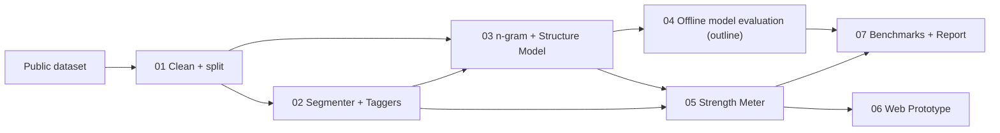

# Master Plan: Probabilistic Password Modeling & Explainable Strength Evaluation

**Course:** CS3002 Information Security (Term Project)
**Team:** Mohib Mansoor (23L-0650) · Maaz Mahmood (23L-0728) · Junaid Muhammad (23L-1014)

## 1. Summary

We train a statistical password model (a character-level n-gram Markov model plus a structural pattern splitter) on a public research dataset (e.g. RockYou), using a strict 80/20 train/test split. We use the model for:

1. **Defender's View (main deliverable):** estimate how guessable a password is, label it **Weak / Medium / Strong**, and explain why in plain language.
2. **Attacker's View (offline evaluation):** measure how well the model predicts the held-out test split, and compare it to a frequency-wordlist baseline (see Plan 04, which is an outline only).

The meter is benchmarked against simple rule-based (LUDS) checks and **zxcvbn**.

## 2. Ethics rules (every phase)

- Offline only. No real accounts, systems, websites or hashes.
- The raw dataset lives in `data/raw/`, is git-ignored, and is never redistributed.
- The web meter never stores, logs or sends passwords anywhere.
- Reports show aggregate statistics only.

## 3. Architecture



## 4. Tech stack

Python 3.11+. The core engine is written by us using the standard library. `numpy` and `matplotlib` for evaluation, `pytest` for tests, `zxcvbn` (baseline only), `Flask` for the web demo.

## 5. Repository layout

```
IS_Project/
├── PLAN.md, README.md, requirements.txt, config.yaml, .gitignore
├── plans/                 per-feature plans (01–07)
├── data/{raw,processed}/  (git-ignored)
├── models/                (git-ignored)
├── src/pwlab/
│   ├── data/prepare.py
│   ├── patterns/segmenter.py, taggers.py, wordlists/
│   ├── model/markov.py, structure.py, facade.py
│   ├── meter/estimator.py, scorer.py, explain.py, baselines.py
│   ├── eval/model_eval.py, meter_eval.py, plots.py
│   └── cli.py
├── web/app.py, templates/, static/
├── tests/
└── reports/figures/, results/, final_report.md
```

## 6. Execution order

| # | Plan | Delivers | Depends on |
|---|---|---|---|
| 01 | [Setup & Data](plans/01_setup_and_data.md) | Skeleton, config, clean split | – |
| 02 | [Segmentation & Tagging](plans/02_segmentation_and_tagging.md) | L/D/S splitter, habit taggers | 01 |
| 03 | [Statistical Model](plans/03_statistical_model.md) | n-gram + structure model | 01, 02 |
| 04 | [Attacker's View (outline)](plans/04_attacker_view_outline.md) | Offline evaluation design | 03 |
| 05 | [Strength Meter](plans/05_strength_meter.md) | Guess-number estimate, score, explanations | 02, 03 |
| 06 | [Web Prototype](plans/06_web_prototype.md) | Privacy-preserving UI | 05 |
| 07 | [Benchmarking & Report](plans/07_benchmarking_and_report.md) | Comparisons, figures, analysis | 04, 05 |

## 7. Team split and milestones

| Week | Milestone | Owner(s) |
|---|---|---|
| 1 | 01 + 02 done | A (data), B (taggers) |
| 2 | 03 done | A |
| 3 | 04 + 05 first results | C (eval), B (explanations) |
| 4 | 06 done, benchmarks running | B, C |
| 5 | 07 report and presentation | All |

## 8. Definition of done

- [ ] `python -m pwlab.cli prepare | train | evaluate | score` work end-to-end.
- [ ] Every password gets Weak/Medium/Strong plus at least one human-readable reason.
- [ ] Meter benchmark table vs. LUDS and zxcvbn.
- [ ] Web demo works locally. Verified that nothing is stored or logged.
- [ ] `pytest` passes. `reports/final_report.md` written.

