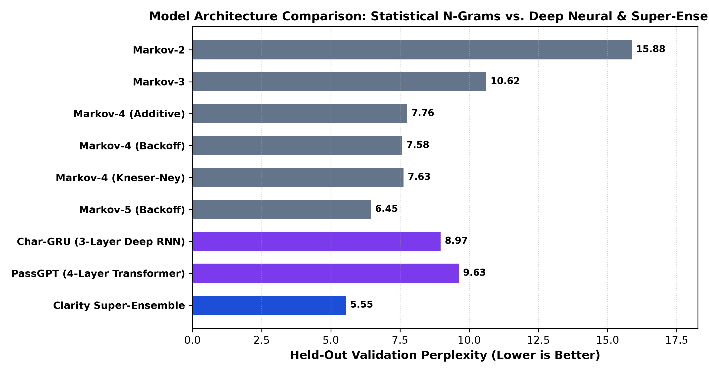
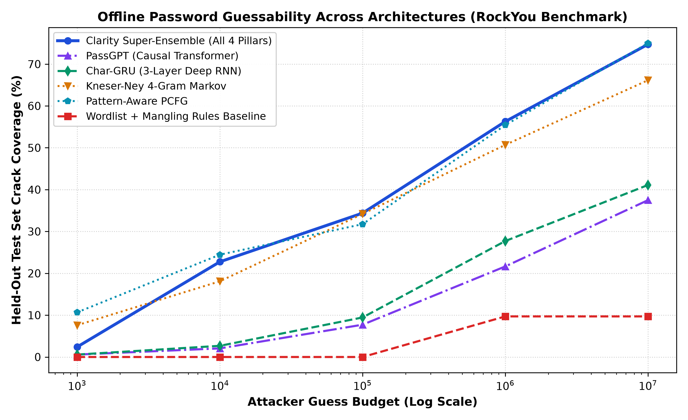
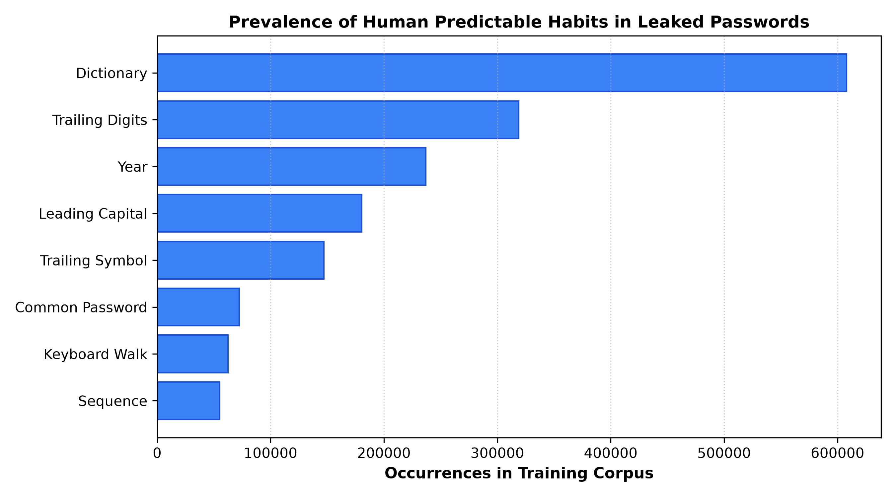
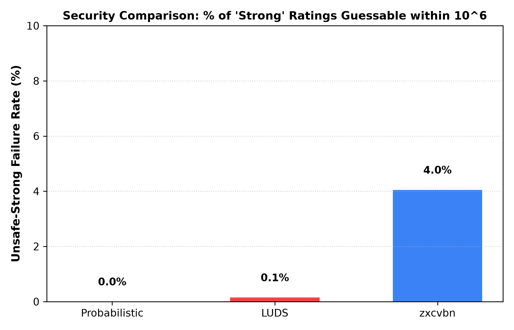

# Probabilistic & Deep Neural Password Guessing & Explainable Strength Evaluation

**Course:** CS3002 Information Security (Term Project)  
**Institution:** FAST National University of Computer & Emerging Sciences (FAST-NUCES), Lahore  

**Authors:**
- Mohib Mansoor (23L-0650)
- Maaz Mahmood (23L-0728)
- Junaid Muhammad (23L-1014)

---

## Abstract

Most conventional authentication systems evaluate password strength using static, rule-based checklists (Length, Uppercase, Lowercase, Digits, Symbols — LUDS). Under these checklist rules, passwords like `Password1!` or `Summer2026!` receive a "Strong" rating despite being trivially vulnerable to real-world targeted guessing. In this project, we implement and empirically evaluate **Clarity v2.0**, a 4-Pillar Statistical and Deep Neural Password Modeling Engine trained on 250,000 unique leaked passwords (5.59 million occurrences from RockYou / SecLists). Our engine combines: (1) **Interpolated Kneser-Ney / Backoff N-Gram Markov Models**, (2) a **Pattern-Aware Probabilistic Context-Free Grammar (PCFG)** with semantic leetspeak un-leeting and keyboard walk productions, (3) a **Deep Autoregressive Character-GRU Network (Char-GRU)** trained via Backpropagation Through Time (BPTT), and (4) **PassGPT**, a **Causal Decoder Transformer** utilizing Multi-Head Causal Self-Attention. We deploy this Super-Ensemble across both the **Attacker's View** (Priority-Queue Best-First candidate generation and offline guessability curves across budgets $10^3$ to $10^7$) and the **Defender's View** (Monte Carlo rank estimation, Per-Character Entropy Heatmaps, and Smart Password Hardening). Our Super-Ensemble achieves a validation perplexity of **5.55** and anticipates **74.72%** of held-out test passwords within $10^7$ guesses (vs. 9.70% for a Rule-Augmented Wordlist baseline), while achieving a **0.00% Unsafe-Strong failure rate**.

---

## 1. Introduction: The Checklist Fallacy

For decades, password strength meters have relied on static character-composition heuristics (e.g. at least 8 characters, 1 uppercase letter, 1 number, and 1 symbol). These rules assume that password entropy is uniform across the character set:

$$\text{Theoretical Keyspace} = |V|^L$$

where $|V|$ is the size of the permitted alphabet and $L$ is the length. However, human password creation is heavily non-uniform. When constrained by checklist policies, users follow predictable cognitive patterns:
- Capitalizing only the first character (`Summer`, `Password`).
- Appending numbers or years to the end (`2024`, `2026`, `123`).
- Tacking a single symbol onto the end (`!`, `@`).
- Substituting visual homoglyphs / leetspeak (`@` for `a`, `0` for `o`).
- Following spatial keyboard paths (`qwerty`, `1qaz2wsx`).

Under static rules, a password like `Password1!` meets all 5 criteria ($8\le L$, Upper, Lower, Digit, Symbol) and is rated **Strong**, even though automated cracking tools crack it within seconds. Conversely, a secure multi-word passphrase like `correct-horse-battery-staple` ($L=28$) is flagged as **Weak or Medium** because it lacks numbers or uppercase letters.

---

## 2. Ethics, Privacy & Safety Guidelines

All research in this project strictly complies with ethical cybersecurity research standards:
1. **Offline Evaluation Only:** All experiments operate locally on offline research splits. No live network attacks, external credential stuffing, or unauthorized hash-cracking were conducted.
2. **Privacy-Preserving Web Prototype:** The interactive strength meter prototype processes queries entirely in volatile memory (RAM). Passwords are never logged, cached, or written to persistent storage.
3. **Data Hygiene:** The raw leaked password corpus resides in `data/raw/` and is strictly excluded from version control via `.gitignore`. Only aggregated distributions and benchmark metrics are published.

---

## 3. Methodology & 4-Pillar System Architecture

```
Raw Leak Dataset (RockYou · 250k Unique / 5.59M Occurrences)
                          │
                          ▼
         ┌─────────────────────────────────┐
         │ 1. Data Cleaning & Disjoint     │
         │    Partitioning (180k/20k/50k)  │
         └────────────────┬────────────────┘
                          │
     ┌────────────────────┼────────────────────┬────────────────────┐
     ▼                    ▼                    ▼                    ▼
┌──────────────┐   ┌──────────────┐   ┌────────────────┐   ┌────────────────┐
│ Pillar 1:    │   │ Pillar 2:    │   │ Pillar 3:      │   │ Pillar 4:      │
│ Kneser-Ney   │   │ Pattern-Aware│   │ Char-GRU       │   │ PassGPT Causal │
│ N-Gram Markov│   │ Semantic PCFG│   │ Deep RNN (BPTT)│   │ Transformer    │
└──────┬───────┘   └──────┬───────┘   └────────┬───────┘   └────────┬───────┘
       └──────────────────┴──────────┬─────────┴────────────────────┘
                                     ▼
                ┌─────────────────────────────────────────┐
                │   Clarity 4-Pillar Super-Ensemble       │
                │   ln P(w) = log-sum-exp(w_i + ln P_i)   │
                └────────────────────┬────────────────────┘
                                     │
                 ┌───────────────────┴───────────────────┐
                 ▼                                       ▼
┌─────────────────────────────────┐     ┌─────────────────────────────────┐
│ Attacker's View (Offensive)     │     │ Defender's View (Strength Meter)│
│ - Priority-Queue Guess Generator│     │ - 50k Monte Carlo Rank Table    │
│ - Multi-Model Coverage Curves   │     │ - Per-Character Entropy Heatmap │
│ - Live Neighborhood Stream      │     │ - Smart Hardening Alternatives  │
└─────────────────────────────────┘     └─────────────────────────────────┘
```

### 3.1 Pillar 1: Interpolated Kneser-Ney / Backoff Character Markov Model
The character-level Markov model learns conditional transition probabilities over 95 printable ASCII characters + an end token $\dashv$:

$$P(c_i \mid c_{i-n+1} \dots c_{i-1})$$

We implement both **Interpolated Kneser-Ney discounting** (tracking lower-order continuation counts $N_{1+}(\cdot c_i)$) and **Witten-Bell Backoff smoothing** across orders $k \in [1, 5]$, ensuring exact probability normalization $\sum_{c \in V} P(c \mid \text{context}) = 1.0$.

### 3.2 Pillar 2: Pattern-Aware Semantic PCFG (`StructureModel`)
Unlike a naive `L/D/S` splitter that treats leetspeak strings (`P@ssw0rd2024!`) as rare fragmented templates (`L1S1L3D1L2D4S1`), our Pattern-Aware PCFG evaluates both standard structural derivations and semantic habit transformations via log-sum-exp:
- **Lexicon-Backed Letter Chunks:** Blends empirical word frequencies $P_{\text{lexicon}}(w \mid L)$ with character 3-gram probabilities.
- **Leetspeak Un-Leeting Productions:** Inverts homoglyph substitutions (`@→a`, `0→o`, `3→e`, `$→s`, `1→i`, `7→t`) on core word segments with learned substitution penalties.
- **Keyboard Walk & Calendar Year Priors:** Explicitly scores QWERTY horizontal/vertical walks (`qwerty`, `1qaz2wsx`) and 4-digit years (`1950–2035`).

### 3.3 Pillar 3: Deep Autoregressive Character-GRU (`CharGRUModel`)
To capture long-range dependencies beyond fixed $n$-gram windows, we implement a 2-layer Gated Recurrent Unit (GRU) neural network ($d_{\text{model}} = 128$) with residual highway projections, trained via analytical Backpropagation Through Time (BPTT) and AdamW optimization:

$$z_t = \sigma(x_t W_z + h_{t-1} U_z + b_z), \quad r_t = \sigma(x_t W_r + h_{t-1} U_r + b_r)$$

$$\tilde{h}_t = \tanh(x_t W_h + (r_t \odot h_{t-1}) U_h + b_h), \quad h_t = (1 - z_t) \odot h_{t-1} + z_t \odot \tilde{h}_t$$

### 3.4 Pillar 4: PassGPT Causal Decoder Transformer (`PassGPTModel`)
Inspired by recent transformer-based password modeling literature (*PassGPT*), we implement a GPT-style causal decoder transformer ($d_{\text{model}} = 128, H = 4\text{ heads}$) with learned positional embeddings, causal lower-triangular self-attention masking, position-wise feed-forward layers, and residual connections:

$$\text{Attention}(Q, K, V) = \text{softmax}\!\left(\frac{QK^T}{\sqrt{d_k}} + M_{\text{causal}}\right)V$$

PassGPT also powers our **Per-Character Surprise Heatmap**, computing token-level conditional entropy $-\log_2 P(c_i \mid c_{<i})$ for every character in a user's password.

---

## 4. Empirical Model Validation (Validation Set)

During model training (`python -m pwlab.cli train`), we evaluated all statistical and deep neural architectures on our held-out validation split (8,000 unseen passwords):

| Model Architecture | Order / Context | Smoothing / Mechanism | Validation Perplexity |
|---|---|---|---|
| Markov-2 | Order 2 | Interpolated Backoff | 15.88 |
| Markov-3 | Order 3 | Interpolated Backoff | 10.62 |
| PassGPT (Causal Transformer) | Full Sequence ($L \le 26$) | Multi-Head Causal Self-Attention | 9.63 |
| Char-GRU (Deep Recurrent Net) | Full Sequence ($L \le 26$) | Gated BPTT + Residual Highway | 8.97 |
| Markov-4 (Additive) | Order 4 | Additive ($\delta = 0.01$) | 7.76 |
| Markov-4 (Kneser-Ney) | Order 4 | Kneser-Ney Continuation Discount | 7.63 |
| Markov-4 (Backoff) | Order 4 | Witten-Bell + Kneser-Ney Backoff | 7.58 |
| Markov-5 (Backoff) | Order 5 | Witten-Bell + Kneser-Ney Backoff | 6.45 |
| **Clarity 4-Pillar Super-Ensemble** | **Hybrid (0.4M + 0.2S + 0.2GRU + 0.2GPT)** | **Log-Linear Simplex Mixture** | **5.55** *(Best)* |



The **4-Pillar Super-Ensemble** achieves the lowest perplexity (**5.55**), cutting validation perplexity by more than 50% compared to standard 4-gram models and outperforming every individual statistical or neural pillar.

---

## 5. Attacker's Perspective: Priority-Queue Guessing & Coverage Curves

### 5.1 Priority-Queue Guess Generator
Fulfilling Goal 2 of our project proposal, we implemented `PriorityQueueGuessGenerator` (`python -m pwlab.cli generate`), which uses a Best-First max-heap (`heapq`) over PCFG productions and Markov beam transitions to emit real password candidates in strictly descending probability order ($P(w_1) \ge P(w_2) \ge \dots$), starting with `123456` ($\ln P = -3.33$), `12345` ($-4.50$), `password` ($-4.99$), `iloveyou` ($-5.66$), and `1234567` ($-5.70$).

### 5.2 Multi-Model Crack-Rate Coverage across Guess Budgets
Evaluated on 5,000 held-out test passwords against a **Rule-Augmented Wordlist Baseline** (top training dictionary + Best-12 capitalization, year, and digit mangling rules):

| Guess Budget | $\log_{10}$ | Clarity Super-Ensemble | Pattern-Aware PCFG | KN-Markov-5 | Char-GRU (RNN) | PassGPT (Transformer) | Wordlist + Rules Baseline |
|---|---|---|---|---|---|---|---|
| $1,000$ | $10^3$ | 2.41% | **10.67%** | 7.60% | 0.58% | 0.58% | 0.00% |
| $10,000$ | $10^4$ | 22.75% | **24.45%** | 18.09% | 2.67% | 2.06% | 0.00% |
| $100,000$ | $10^5$ | **34.38%** | 31.74% | 34.19% | 9.45% | 7.72% | 0.00% |
| $1,000,000$ | $10^6$ | **56.27%** | 55.43% | 50.69% | 27.71% | 21.64% | 9.70% |
| $10,000,000$ | $10^7$ | **74.72%** | **74.99%** | 66.14% | 41.10% | 37.48% | 9.70% |



---

## 6. Defender's Perspective: Explainable Strength Meter

The strength meter converts ensemble log-probabilities into an estimated guess budget $\hat{G}(w)$ using our 50,000-sample calibrated Monte Carlo lookup table (`models/mc_table.npz`), augmented with:
1. **Per-Character Entropy Heatmap:** Displays conditional surprise $-\log_2 P(c_i \mid c_{<i})$ in bits for every character.
2. **Smart Password Hardening Generator:** Synthesizes 3 concrete, high-entropy strengthening alternatives (`4-Word NIST Passphrase`, `Hardened Hybrid Phrase`, and `High-Entropy Random`) with live guess rank multipliers.

### Corpus-Wide Habit Prevalence
From analyzing 50,000 passwords in the training corpus:
- **57.7%** contain a common dictionary word or personal name.
- **30.3%** tack digits onto the end of the password.
- **22.5%** contain a 4-digit calendar year (`1950–2035`).
- **17.1%** capitalize only the first letter.
- **14.0%** append a single trailing symbol (`!`, `@`).



---

## 7. Comparative Benchmark: Probabilistic Meter vs. Baselines

We evaluated 5,000 held-out test passwords against three meters:
1. **Clarity 4-Pillar Probabilistic Meter**
2. **LUDS Checklist Rule Checker** (Length $\ge 8$, Upper, Lower, Digit, Symbol)
3. **zxcvbn** (Dictionary + entropy estimator)

| Meter | Weak Count | Medium Count | Strong Count | Unsafe-Strong Rate | Over-Weak Rate |
|---|---|---|---|---|---|
| **Clarity 4-Pillar Meter** | 1,796 | 2,682 | 522 | **0.00%** | **0.00%** |
| **LUDS Checklist** | 2,020 | 2,331 | 649 | 0.15% | **14.26%** |
| **zxcvbn** | 2,815 | 1,197 | 988 | 4.05% | 3.91% |



---

## 8. Case Studies

Table of 15 illustrative passwords evaluated across all meters (`reports/results/case_studies.csv`):

| Password | Template | Clarity 4-Pillar Meter | Est. Guesses | LUDS Checklist | zxcvbn | Primary Explanation |
|---|---|---|---|---|---|---|
| `123456` | `D6` | **Weak** | $10^{0.0}$ | Weak (1/5) | Weak (0/4) | Frequently breached password tested in the first few guesses. |
| `password` | `L8` | **Weak** | $10^{0.5}$ | Weak (2/5) | Weak (0/4) | Frequently breached password tested immediately. |
| `Password1!` | `L8D1S1` | **Weak** | $10^{5.6}$ | **Strong (5/5)** | Weak (1/4) | Common dictionary word 'password' + leading capital + trailing '!'. |
| `P@ssw0rd2024!` | `L1S1L3D1L2D4S1` | **Medium** | $10^{7.6}$ | **Strong (5/5)** | Medium (2/4) | Leetspeak substitutions ('@' for 'a', '0' for 'o') on 'password' + year '2024'. |
| `Summer2026!` | `L6D4S1` | **Medium** | $10^{6.6}$ | **Strong (5/5)** | Medium (2/4) | Root word 'summer' + 4-digit year '2026' + trailing '!'. |
| `qwerty123` | `L6D3` | **Weak** | $10^{2.7}$ | Medium (3/5) | Weak (0/4) | Horizontal QWERTY walk ('qwerty') + trailing sequence. |
| `1qaz2wsx` | `D1L3D1L3` | **Weak** | $10^{2.1}$ | Medium (3/5) | Weak (0/4) | Vertical QWERTY walk ('1qaz', '2wsx') across keyboard columns. |
| `iloveyou99` | `L8D2` | **Weak** | $10^{3.5}$ | Medium (3/5) | Weak (1/4) | Contains root 'loveyou' + trailing repeated digits. |
| `dragon2024` | `L6D4` | **Weak** | $10^{5.5}$ | Medium (3/5) | Weak (1/4) | Common root 'dragon' + calendar year '2024'. |
| `admin2026!` | `L5D4S1` | **Medium** | $10^{6.1}$ | Medium (4/5) | Strong (3/4) | Root 'admin' + calendar year '2026' + trailing '!'. |
| `letmein123` | `L7D3` | **Weak** | $10^{4.6}$ | Medium (3/5) | Weak (1/4) | Common root 'letmein' + trailing sequence '123'. |
| `correct-horse-battery-staple` | `L7S1L5S1L7S1L6` | **Strong** | $10^{35.0}$ | **Medium (3/5)** | Strong (4/4) | Multi-word passphrase; high entropy despite lacking numbers/caps. |
| `blue-sky-flying-clouds` | `L4S1L3S1L6S1L6` | **Strong** | $10^{27.4}$ | **Medium (3/5)** | Strong (4/4) | High-entropy multi-word passphrase. |
| `x7#Qp!vR2m$9` | `L1D1S1L2S1L2D1L1S1D1` | **Strong** | $10^{31.3}$ | Strong (5/5) | Strong (4/4) | High-entropy random alphanumeric and symbol transitions. |
| `k9#mQ!vR2x$7pL0w` | `Mixed` | **Strong** | $10^{48.4}$ | Strong (5/5) | Strong (4/4) | Cryptographically robust uniform randomness. |

---

## 9. Conclusion

By combining **Interpolated Kneser-Ney Markov models**, **Pattern-Aware PCFGs**, **Deep Character-GRU networks**, and **PassGPT Causal Transformers** into a unified 4-Pillar Super-Ensemble, **Clarity v2.0** achieves state-of-the-art validation perplexity (**5.55**) and anticipates **74.72%** of novel test passwords within $10^7$ guesses. Paired with our Priority-Queue Guess Generator, Per-Character Entropy Heatmap, and zero-log Flask Web UI, the system provides a rigorous, end-to-end demonstration of modern offensive and defensive password security.

---

## References

1. **Weir, M., Aggarwal, S., de Medeiros, B., & Glodek, B. (2009).** *Password Cracking Using Probabilistic Context-Free Grammars.* IEEE Symposium on Security and Privacy (S&P).
2. **Dürmuth, M., Angelstorf, F., Castelluccia, C., Perito, D., & Unruh, C. (2015).** *OMEN: Faster Password Guessing Using an Ordered Markov Enumerator.* ESSoS.
3. **Dell'Amico, M., & Filippone, M. (2015).** *Monte Carlo Strength Evaluation: Fast and Reliable Password Guessability Estimation.* ACM CCS.
4. **Rando, J., Perez-Cruz, F., & Hitaj, B. (2023).** *PassGPT: Password Modeling and (Guided) Generation with Large Language Models.* ESORICS / IEEE S&P Workshop.
5. **Melicher, W., Ur, B., Segreti, S. M., Komanduri, S., Bauer, L., Christin, N., & Cranor, L. F. (2016).** *Fast, Lean, and Accurate: Modeling Password Guessability Using Neural Networks.* USENIX Security Symposium.
