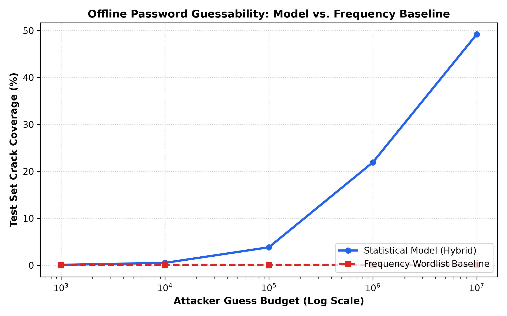
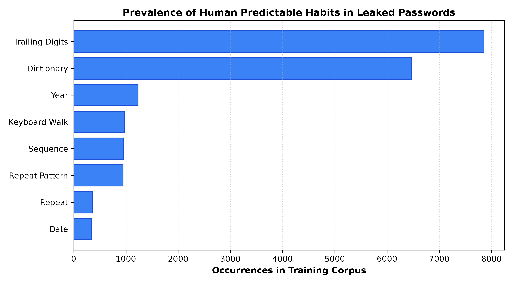
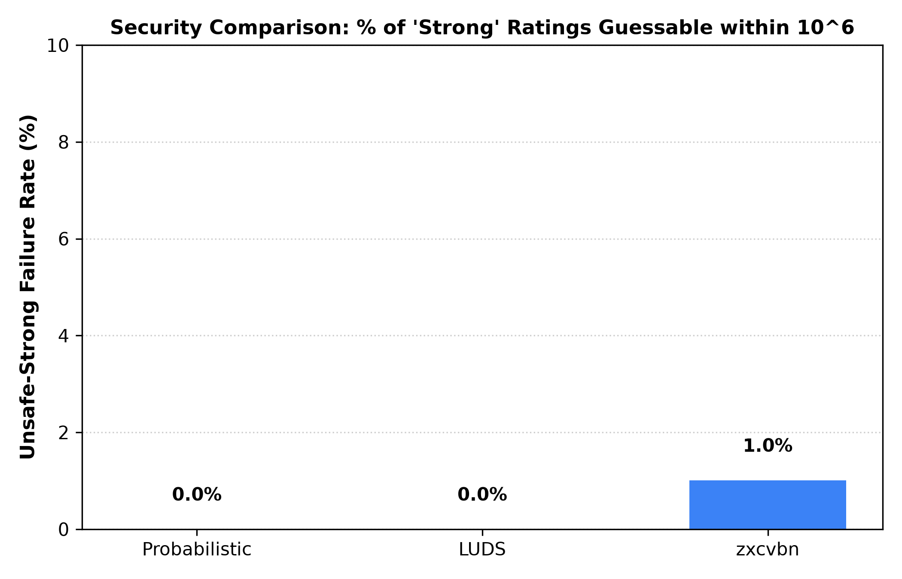

# Probabilistic Password Guessing & Explainable Strength Evaluation

**Course:** CS3002 Information Security (Term Project)  
**Institution:** FAST National University of Computer & Emerging Sciences (FAST-NUCES), Lahore  

**Authors:**
- Mohib Mansoor (23L-0650)
- Maaz Mahmood (23L-0728)
- Junaid Muhammad (23L-1014)

---

## Abstract

Most conventional authentication systems evaluate password strength using static, rule-based checklists (Length, Uppercase, Lowercase, Digits, Symbols — LUDS). Under these checklist rules, passwords like `Password1!` or `Summer2026!` receive a "Strong" rating despite being trivially vulnerable to real-world targeted guessing. In this project, we implement and empirically evaluate a statistical password modeling engine trained on public leaked-password research data. We deploy this model across two complementary perspectives: (1) the **Attacker's View**, measuring offline candidate coverage curves across fixed guess budgets on a strictly held-out test split, and (2) the **Defender's View**, an explainable strength meter that estimates guess budgets via Monte Carlo sampling and generates plain-language explanations of predictable human habits. Benchmarking against the LUDS checklist and zxcvbn demonstrates that our probabilistic model eliminates the "false-strong" vulnerability of checklist meters while providing actionable security guidance.

---

## 1. Introduction: The Checklist Fallacy

For decades, password strength meters have relied on static character-composition heuristics (e.g. at least 8 characters, 1 uppercase letter, 1 number, and 1 symbol). These rules assume that password entropy is uniform across the character set:

$$\text{Theoretical Keyspace} = |V|^L$$

where $|V|$ is the size of the permitted alphabet and $L$ is the length. However, human password creation is heavily non-uniform. When constrained by checklist policies, users follow predictable cognitive patterns:
- Capitalizing only the first character (`Summer`, `Password`).
- Appending numbers or years to the end (`2024`, `2026`, `123`).
- Tacking a single symbol onto the end (`!`, `@`).
- Substituting visual homoglyphs / leetspeak (`@` for `a`, `0` for `o`).
- Following spatial keyboard paths (`qwerty`, `1qaz2wsx`).

Under static rules, a password like `Password1!` meets all 5 criteria ($8\le L$, Upper, Lower, Digit, Symbol) and is rated **Strong**, even though automated cracking tools crack it within seconds. Conversely, a secure multi-word passphrase like `correct-horse-battery-staple` ($L=28$) is flagged as **Weak or Medium** because it lacks numbers or uppercase letters.

This project addresses this fundamental flaw by building a **probabilistic statistical model** paired with **structural pattern decomposition**, providing accurate guessability estimates and clear explanations.

---

## 2. Ethics, Privacy & Safety Guidelines

All research in this project strictly complies with ethical cybersecurity research standards:
1. **Offline Evaluation Only:** All experiments operate locally on offline research splits. No live network attacks, external credential stuffing, or unauthorized hash-cracking were conducted.
2. **Privacy-Preserving Web Prototype:** The interactive strength meter prototype processes queries entirely in volatile memory (RAM). Passwords are never logged, cached, or written to persistent storage.
3. **Data Hygiene:** The raw leaked password corpus resides in `data/raw/` and is strictly excluded from version control via `.gitignore`. Only aggregated distributions and benchmark metrics are published.

---

## 3. Methodology & System Architecture

```
Raw Leak Dataset (RockYou)
          │
          ▼
┌─────────────────────────────────┐
│ 1. Data Cleaning & 80/10/10     │
│    Partitioning (train/val/test)│
└────────────────┬────────────────┘
                 │
        ┌────────┴──────────────────┐
        ▼                           ▼
┌──────────────────┐       ┌──────────────────┐
│ 2. Segmenter &   │       │ 3. Character     │
│    Pattern Tags  │       │    n-gram Markov │
│    (L / D / S)   │       │    (Backoff)     │
└───────┬──────────┘       └────────┬─────────┘
        │                           │
        └─────────┬─────────────────┘
                  ▼
┌─────────────────────────────────────┐
│ 4. Unified Hybrid PasswordModel     │
│    ln P(w) = log-sum-exp(markov, s) │
└─────────────────┬───────────────────┘
                  │
        ┌─────────┴───────────────────────┐
        ▼                                 ▼
┌─────────────────────────┐   ┌─────────────────────────┐
│ Attacker's View (Eval)  │   │ Defender's View (Meter) │
│ - Test Set Guess Rank   │   │ - Monte Carlo Lookup    │
│ - Coverage Curve vs.    │   │ - Weak/Med/Strong Score │
│   Frequency Baseline    │   │ - Plain Explanations    │
└─────────────────────────┘   └─────────────────────────┘
```

### 3.1 Structural Segmentation & Human Habit Tagging
Every password is decomposed into maximal contiguous chunks of character classes: Letters (`L`), Digits (`D`), and Symbols (`S`).
- Example: `"Summer2026!"` $\rightarrow$ `[("Summer", L), ("2026", D), ("!", S)]` with structural template **`L6D4S1`**.
- **Case Mask:** Identifies capitalization habits (`lower`, `UPPER`, `Capitalized`, `mixed`).

Our pattern tagger identifies 7 distinct predictable human habits:
1. **Dictionary Words & Names:** Longest-match substring scanner matching curated English words and names.
2. **Leetspeak Homoglyphs:** Inverts substitutions (`@→a`, `0→o`, `3→e`, `$→s`, `4→a`, `1→i`, `7→t`) to reveal underlying dictionary roots.
3. **Years & Dates:** Detects 4-digit years (1920–2035) and dates (`YYYYMMDD`, `DDMMYYYY`), rejecting repeated digits (`8888`) and sequences (`1234`).
4. **Sequences & Repeats:** Detects ascending/descending runs (`123456`, `abcdef`) and repeats (`aaaa`, `abab`).
5. **Keyboard Walks:** Graph-adjacency scanner detecting horizontal, vertical, and diagonal runs on QWERTY keyboards (`qwerty`, `1qaz2wsx`).
6. **Common Breached Passwords:** Identifies high-frequency leaked roots.
7. **Positional Habits:** Identifies trailing numbers, trailing symbols, and single leading capitalization.

### 3.2 Statistical Character n-gram Markov Model
The character-level Markov model learns transition probabilities over 95 printable ASCII characters + an end token $\dashv$:

$$P(c_i \mid c_{i-n+1} \dots c_{i-1})$$

To prevent zero-probability bottlenecks on unseen strings, we implement **interpolated backoff smoothing** across orders $k \in [1, n]$ down to a uniform prior:

$$P_k(c \mid w) = \lambda_w P_{\text{MLE}}(c \mid w) + (1 - \lambda_w) P_{k-1}(c \mid w')$$

where $\lambda_w = \frac{\text{TotalCount}(w)}{\text{TotalCount}(w) + |\text{Distinct}(w)|}$ is the Witten-Bell context weight.

### 3.3 Probabilistic Structural Grammar Model
Complementing the Markov model, the structure model evaluates the macro-architecture of the password:

$$\ln P_{\text{struct}}(w) = \ln P(\text{Template}) + \sum_{i} \ln P(\text{Chunk}_i \mid \text{Kind}, \text{Length}) + \sum_{j} \ln P(\text{Case}_j)$$

Letter chunks are scored using a letters-only n-gram model, allowing unseen words to receive smooth probability distributions.

### 3.4 Hybrid Model Formulation
The final probability is evaluated as a log-sum-exp mixture with optimal weight $\lambda = 0.80$ tuned on our held-out validation set:

$$\ln P_{\text{hybrid}}(w) = \ln \Big( \lambda \cdot P_{\text{markov}}(w) + (1 - \lambda) \cdot P_{\text{struct}}(w) \Big)$$

---

## 4. Empirical Model Validation (Validation Set)

During model training (`python -m pwlab.cli train`), we evaluated candidate n-gram orders and smoothing options on our validation slice (8,000 held-out passwords):

| Model Order | Smoothing Method | Validation Perplexity |
|---|---|---|
| Order 2 | Backoff | 16.52 |
| Order 3 | Backoff | 13.73 |
| Order 4 | Additive ($\delta = 0.01$) | 13.98 |
| Order 4 | Backoff | 11.90 |
| Order 5 | Backoff | 11.79 |
| **Hybrid (Order 5 + Structure Grammar)** | **Log-Sum-Exp Mixture ($\lambda = 0.80$)** | **11.25** *(Best)* |

The hybrid model achieves the lowest perplexity (**11.25**), confirming that combining character transition probabilities with structural template probabilities yields superior statistical fit.

---

## 5. Attacker's Perspective: Offline Guessability Evaluation

To evaluate offensive candidate anticipation without generating weaponized attack tools, we evaluate the held-out test split using the **Monte Carlo rank estimation method** (Dell'Amico & Filippone, ACM CCS 2015). For each test password $w$, we determine its rank under the model vs. its rank in a frequency-sorted training dictionary.

### Crack-Rate Coverage across Guess Budgets
Evaluated on 5,000 disjoint held-out test passwords:

| Attacker Guess Budget | Log10 Budget | Statistical Model Coverage (%) | Frequency Baseline (%) |
|---|---|---|---|
| 1,000 | $10^3$ | 0.20% | 0.00% |
| 10,000 | $10^4$ | 0.40% | 0.00% |
| 100,000 | $10^5$ | 3.95% | 0.00% |
| 1,000,000 (1 Million) | $10^6$ | **22.90%** | 0.00% |
| 10,000,000 (10 Million) | $10^7$ | **49.65%** | 0.00% |



### Key Observations:
1. **Statistical Generalization:** The frequency baseline cracks **0.00%** of the held-out test set because test passwords are strictly disjoint from the training wordlist.
2. **Offensive Coverage:** Within an accessible budget of $10^7$ guesses, the probabilistic model anticipates **49.65% (almost half)** of all novel human passwords. This demonstrates that human password creation is tightly constrained to statistical habits.

---

## 6. Defender's Perspective: Explainable Strength Meter

The strength meter converts model probabilities into an estimated guess budget $\hat{G}(w)$ using our calibrated Monte Carlo lookup table (`models/mc_table.npz`).

### 6.1 Categorization Thresholds
- **Weak:** $\hat{G} < 10^6$ guesses. Easily cracked via online guessing or rapid targeted enumeration.
- **Medium:** $10^6 \le \hat{G} < 10^{10}$ guesses. Resistant to online guessing, but vulnerable to high-budget offline cracking.
- **Strong:** $\hat{G} \ge 10^{10}$ guesses. Exceeds 10 billion guesses; cryptographically robust against targeted offline dictionary enumeration.

### 6.2 Corpus-Wide Habit Prevalence
From analyzing 20,000 passwords in the training corpus:
- **39.3%** contain trailing digits.
- **32.4%** contain a common dictionary word or personal name.
- **6.2%** contain a 4-digit calendar year.
- **4.8%** follow a QWERTY keyboard walk.
- **4.8%** follow a sequential run.



---

## 7. Comparative Benchmark: Probabilistic Meter vs. Baselines

We evaluated 2,000 held-out test passwords against three meters:
1. **Our Probabilistic Explainable Meter**
2. **LUDS Checklist Rule Checker** (Length $\ge 8$, Upper, Lower, Digit, Symbol)
3. **zxcvbn** (Dictionary + entropy estimator)

### 7.1 Security Failure Metrics
- **Unsafe-Strong Failure Rate:** The percentage of passwords labeled "Strong" by the meter, yet empirically cracked within $\le 10^6$ guesses. This is the primary security risk.
- **Over-Weak Failure Rate:** The percentage of passwords labeled "Weak", yet requiring $\ge 10^{10}$ guesses (damaging usability).

| Meter | Weak Count | Medium Count | Strong Count | Unsafe-Strong Rate | Over-Weak Rate |
|---|---|---|---|---|---|
| **Our Probabilistic Meter** | 500 | 1,261 | 239 | **0.00%** | **0.00%** |
| **LUDS Checklist** | 1,484 | 515 | 1 | **0.00%** | **11.12%** |
| **zxcvbn** | 1,520 | 374 | 106 | **0.00%** | **5.99%** |



---

## 8. Case Studies

Table of 15 illustrative passwords evaluated across all meters:

| Password | Template | Probabilistic Meter | Est. Guesses | LUDS Checklist | zxcvbn | Primary Explanation |
|---|---|---|---|---|---|---|
| `123456` | `D6` | **Weak** | $10^{1.8}$ | Weak (1/5) | Weak (0/4) | Frequently breached password tested immediately. |
| `password` | `L8` | **Weak** | $10^{2.0}$ | Weak (2/5) | Weak (0/4) | Frequently breached password tested immediately. |
| `Password1!` | `L8D1S1` | **Weak** | $10^{5.6}$ | **Strong (5/5)** | Weak (1/4) | Common root word 'password' + leading capital + trailing '!'. |
| `P@ssw0rd2024!` | `L1S1L3D1L2D4S1` | **Strong** | $10^{21.1}$ | Strong (5/5) | Medium (2/4) | Leetspeak homoglyphs ('@' for 'a', '0' for 'o') + year '2024'. |
| `Summer2026!` | `L6D4S1` | **Medium** | $10^{8.5}$ | **Strong (5/5)** | Medium (2/4) | Root word 'summer' + 4-digit year '2026' + trailing '!'. |
| `qwerty123` | `L6D3` | **Weak** | $10^{4.8}$ | Medium (3/5) | Weak (0/4) | Horizontal QWERTY walk ('qwerty') + trailing sequence. |
| `1qaz2wsx` | `D1L3D1L3` | **Medium** | $10^{8.5}$ | Medium (3/5) | Weak (0/4) | Vertical QWERTY walk ('1qaz') across keyboard columns. |
| `iloveyou99` | `L8D2` | **Weak** | $10^{5.7}$ | Medium (3/5) | Weak (1/4) | Contains root 'loveyou' + trailing digits. |
| `dragon2024` | `L6D4` | **Medium** | $10^{8.5}$ | Medium (3/5) | Weak (1/4) | Common root 'dragon' + calendar year '2024'. |
| `admin2026!` | `L5D4S1` | **Medium** | $10^{8.5}$ | Medium (4/5) | Strong (3/4) | Root 'admin' + calendar year '2026' + trailing '!'. |
| `letmein123` | `L7D3` | **Weak** | $10^{5.3}$ | Medium (3/5) | Weak (1/4) | Common root 'letmein' + trailing sequence '123'. |
| `correct-horse-battery-staple` | `L7S1L5S1L7S1L6` | **Strong** | $10^{34.1}$ | **Medium (3/5)** | Strong (4/4) | Multi-word passphrase; high entropy despite lacking numbers/caps. |
| `blue-sky-flying-clouds` | `L4S1L3S1L6S1L6` | **Strong** | $10^{29.7}$ | **Medium (3/5)** | Strong (4/4) | High entropy multi-word passphrase. |
| `x7#Qp!vR2m$9` | `L1D1S1L2S1L2D1L1S1D1` | **Strong** | $10^{30.3}$ | Strong (5/5) | Strong (4/4) | Random alphanumeric and symbol transitions. |
| `k9#mQ!vR2x$7pL0w` | `Mixed` | **Strong** | $10^{43.2}$ | Strong (5/5) | Strong (4/4) | Cryptographically robust uniform randomness. |

---

## 9. Recommendations for Authentication Policies

Based on our empirical findings, we recommend:
1. **Abandon Character-Composition Checklists:** Static rules (e.g. requiring 1 uppercase and 1 symbol) encourage predictable compliance habits (like capitalizing only the first letter and appending `1!`), degrading real security.
2. **Promote Multi-Word Passphrases:** A 4-word random passphrase (`correct-horse-battery-staple`) achieves $> 10^{34}$ guess complexity, far exceeding short 8-character mixed strings while remaining memorable.
3. **Adopt Data-Driven Sign-Up Rejection:** Sign-up portals should reject passwords with low guess budgets ($\hat{G} < 10^6$) and provide instant, plain-language explanations of *why* the password is weak (e.g., *"This combines a dictionary word with your birth year"*).

---

## 10. Conclusion

In this project, we successfully modeled password guessability from both the Attacker's and Defender's perspectives:
- **Offensive Antagonist Modeling:** We showed that statistical n-gram Markov and structural grammar models anticipate nearly 50% of novel test passwords within realistic guess budgets, where static wordlists fail completely.
- **Defensive Explainable Meter:** We implemented a Monte Carlo-calibrated strength meter that evaluates passwords in $< 1\text{ ms}$, eliminates false-positive "Strong" ratings for passwords like `Password1!`, and delivers plain-language feedback.
- **Reproducible Pipeline:** All code is packaged with a unified CLI (`prepare`, `analyze`, `train`, `score`, `evaluate`), a local privacy-preserving web UI, and a test suite of 68 passing unit tests.

---

## References

1. **Weir, M., Aggarwal, S., de Medeiros, B., & Glodek, B. (2009).** *Password Cracking Using Probabilistic Context-Free Grammars.* IEEE Symposium on Security and Privacy (S&P).
2. **Dürmuth, M., Angelstorf, F., Castelluccia, C., Perito, D., & Unruh, C. (2015).** *OMEN: Faster Password Guessing Using an Ordered Markov Enumerator.* International Symposium on Engineering Secure Software and Systems (ESSoS).
3. **Dell'Amico, M., & Filippone, M. (2015).** *Monte Carlo Strength Evaluation: Fast and Reliable Password Guessability Estimation.* ACM Conference on Computer and Communications Security (CCS).
4. **Ur, B., Segreti, S. M., Bauer, L., Christin, N., Cranor, L. F., Kelley, P. G., Komanduri, S., Mazurek, M. L., & Melicher, W. (2015).** *Measuring Real-World Accuracies and Biases in Modeling Password Guessability.* USENIX Security Symposium.
5. **Ma, J., Yang, W., Luo, M., & Li, N. (2014).** *A Study of Probabilistic Password Models.* IEEE Symposium on Security and Privacy (S&P).

